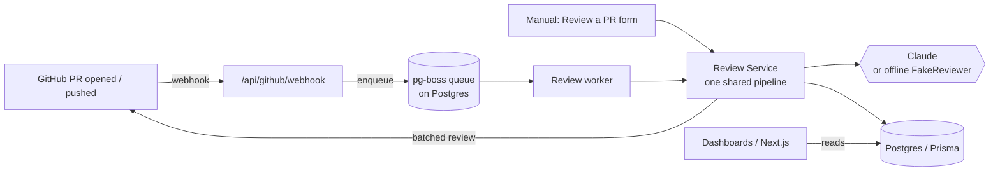
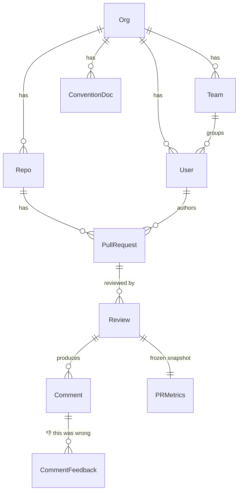
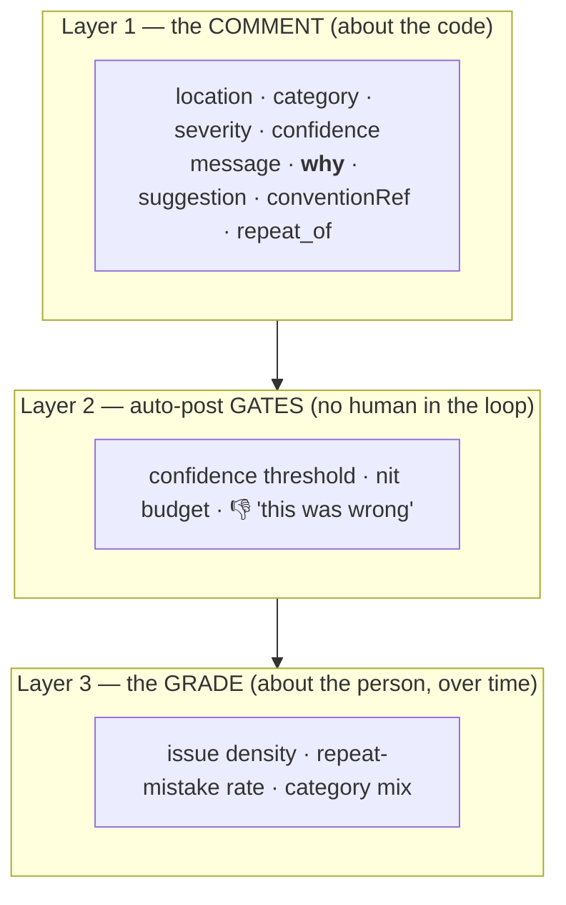
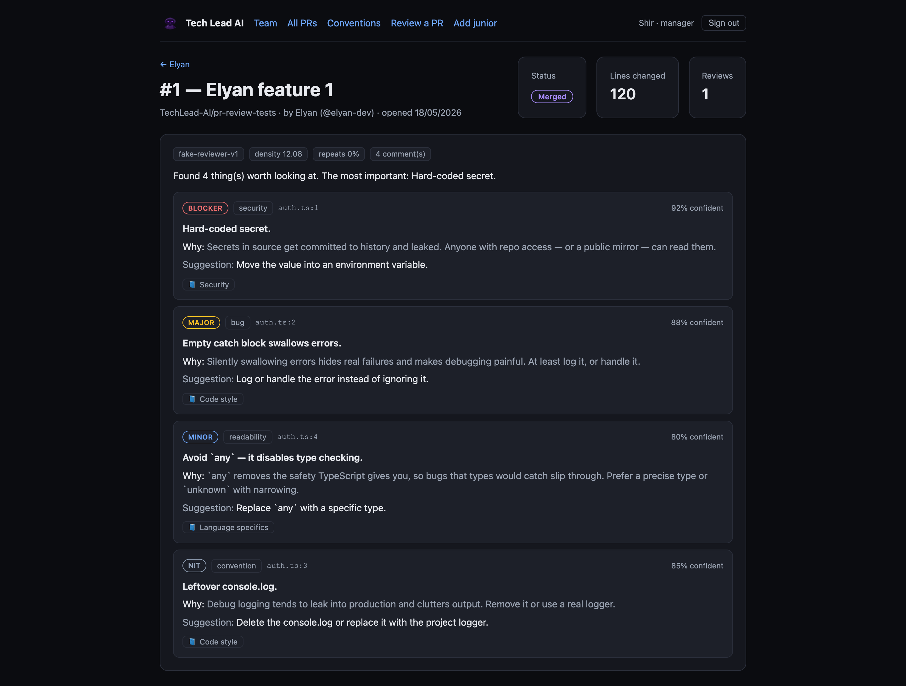
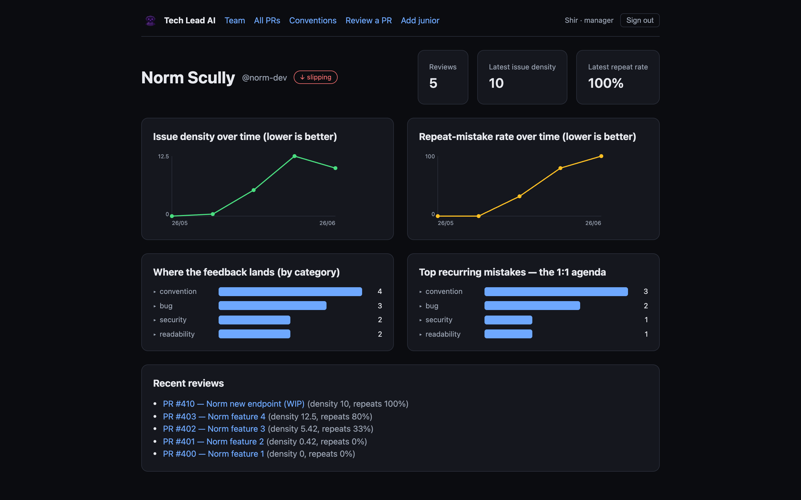
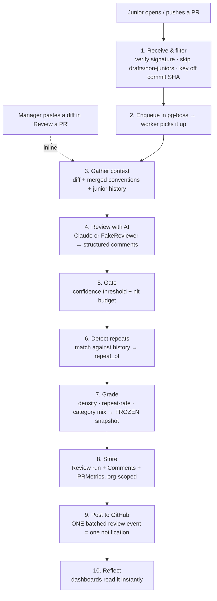
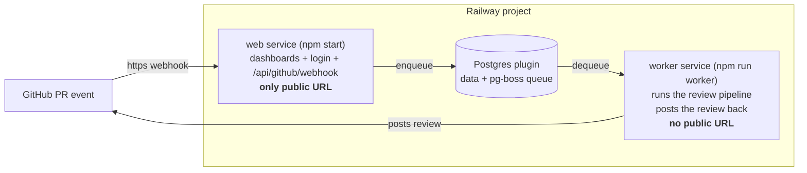

# Tech Lead AI

### An AI senior engineer that mentors junior developers — by reviewing their pull requests, posting feedback on GitHub, and tracking each junior's growth over time.

> **The pitch in one sentence:** most AI reviewers check *a PR*. Tech Lead AI
> mentors *a person* — it remembers past mistakes, frames feedback as growth,
> and gives managers a real picture of how each junior is developing.

*Colman Dev Club · project presentation · presenter & date: __________*


---

## Contents

1. [Purpose — the need we fill](#1-purpose--the-need-we-fill)
2. [Architecture](#2-architecture)
3. [How the main components are built](#3-how-the-main-components-are-built)
4. [A real review, end to end (worked example)](#4-a-real-review-end-to-end-worked-example)
5. [The website — what you can do there](#5-the-website--what-you-can-do-there)
6. [How the review flow works](#6-how-the-review-flow-works)
7. [Deployment — running it for real on Railway](#7-deployment--running-it-for-real-on-railway)
8. [What makes it different (and other highlights)](#8-what-makes-it-different-and-other-highlights)
9. [Risks & honest tradeoffs](#9-risks--honest-tradeoffs)
10. [Roadmap — what's next](#10-roadmap--whats-next)
11. [Closing & quick facts](#11-closing--quick-facts)
- [Appendix — presenting it: demo script & asset checklist](#appendix--presenting-it-demo-script--asset-checklist)

---

## 1. Purpose — the need we fill

Junior developers grow fastest with consistent, high-quality code review. On real
teams that rarely happens:

- **Senior time is scarce.** Thorough reviews are the first thing dropped when the
  team is busy. Juniors get a rushed "LGTM" instead of mentoring.
- **Feedback is inconsistent.** Different reviewers care about different things;
  the junior gets contradictory signals and no clear standard.
- **Nobody tracks growth.** Review comments live and die inside a single PR. No
  one can answer *"is this person actually getting better, and at what?"*

**Tech Lead AI fills that gap.** It acts as a tireless senior reviewer that:

1. Reviews every junior PR against the team's *own* written conventions.
2. Posts mentoring feedback — every comment explains the **why**, not just the what.
3. Remembers each junior over time, so it can spot **repeated mistakes** and show
   **real growth** on a dashboard.

> **North star:** mentor a junior *over time* — not just review one PR. Noticing
> repeated mistakes and showing growth is the core value, more than catching any
> single bug.

**Scope:** internal use today, but architected as multi-tenant SaaS from day one
(`org_id` on every table, org → team → user structure).

---

## 2. Architecture

One Next.js app serves everything (dashboard UI, API, GitHub webhook, and
login/sessions), with a separate worker process so a flood of reviews never
blocks incoming webhooks. (Auth today is a demo cookie standing in for GitHub
OAuth — see §5.)



**Key architectural decisions:**

- **One pipeline, two entry points.** The manual "Review a PR" trigger and the
  GitHub webhook both call the *same* review service (`src/server/review/service.ts`).
  No duplicated logic.
- **Queue-backed reviews.** GitHub webhooks enqueue work via **pg-boss** (a queue
  that runs on the existing Postgres — no Redis needed). The worker consumes it,
  so webhook delivery stays fast and we can cap concurrent expensive AI calls.
- **Idempotency by commit SHA.** Duplicate/retried webhooks never cause a
  double-review or double-post.
- **Multi-tenant from day one.** `org_id` on every table and every query;
  org → team → user → repo hierarchy. Cheap now, miserable to retrofit later.
- **Frozen metric snapshots.** Per-PR metrics are written once and never
  recomputed. The model and scoring formula will change; progress charts must
  stay stable.
- **Offline-first demo.** With no `ANTHROPIC_API_KEY`, a `FakeReviewer` scans the
  diff for common smells, so the whole system runs and demos without any cloud
  dependency.

**The data model** (Postgres via Prisma):



**Stack:** TypeScript + Next.js (App Router), Postgres via Docker Compose, Prisma
ORM, pg-boss queue, Anthropic SDK, Octokit (GitHub App), Vitest for tests.

---

## 3. How the main components are built

The system is the **9 components** from `DESIGN.md`. The ones that carry the product:

### Convention config — "what good means" (component 2)
The manager writes the team's standard as **templated markdown**, **layered**
org → team → repo, and the engine **merges** all three layers for each PR's
author. Docs are **versioned**: a review references the rules *as they were when
it ran*, so old reviews stay coherent after the manager edits conventions.
→ `src/server/conventions/merge.ts`, `src/server/db/conventions.ts`

### Review Engine — the AI brain (component 3)
A small, discrete-step pipeline (`src/server/review/pipeline.ts`) —
*gather context → review → gate → detect repeats → grade* — built as separate
steps so future features (a self-check pass, fix-acknowledgment) slot in cleanly.
The end-to-end run is walked through in [§6](#6-how-the-review-flow-works); what
matters here is *how* it's built:

- **Convention-grounded.** Every comment maps to a rule or stated principle — no
  hallucinated opinions — and the model assigns a **severity** + **confidence**.
- **Swappable reviewer.** The reviewer is an **interface** with two
  implementations — `FakeReviewer` (offline) and `AnthropicReviewer` (Claude) —
  picked by a `factory` from env. That's why the whole pipeline is testable, and
  demoable, offline.

#### How we actually steer the AI (the cool part)

The Claude reviewer (`src/server/review/anthropic-reviewer.ts`) is not "ask the
model what it thinks." It's deliberately constrained:

- **A strict system prompt** sets the persona ("a senior engineer mentoring a
  junior"), the tone ("encouraging but honest"), and one hard rule: *explain WHY
  it matters in a way a junior can learn from*. It's told **"Only flag real issues
  — do not invent problems. Prefer fewer, high-value comments."**
- **Structured output, validated.** The model must return a JSON object of a fixed
  shape. We then parse it through the **exact same Zod schema** the rest of the
  app uses (`ReviewResultSchema.parse(...)`) — if the model returns a bad shape, it
  throws. No free-form prose leaks into the product.
- **Context is injected, not assumed.** The user prompt is assembled from the PR
  title, the merged team conventions, the junior's recent mistake categories, and
  the diff. The history line literally says *"if you see the same kind of issue
  again, mention that it's a recurring pattern."*

```ts
// Every comment the engine emits is validated against this — the why is mandatory.
export const ReviewCommentSchema = z.object({
  filePath: z.string().min(1),
  lineStart: z.number().int().nonnegative(),
  lineEnd: z.number().int().nonnegative(),
  category: z.enum(CATEGORIES),     // bug | security | design | test | convention | readability | naming
  severity: z.enum(SEVERITIES),     // blocker | major | minor | nit
  confidence: z.number().min(0).max(1),
  message: z.string().min(1),
  why: z.string().min(1),           // ← the mentoring. Not optional.
  suggestion: z.string().optional(),
  conventionRef: z.string().optional(),
});
```

### Comment + Grading model — keeping 3 layers distinct (component 4)



- **Layer 1 (the comment, about the code):** `location`, `category`, `severity`
  (blocker/major/minor/nit), `confidence`, `message`, and a **mandatory `why`**
  (the mentoring), plus optional `suggestion`, `convention_ref`, `repeat_of`.
- **Layer 2 (auto-post gates, no human in the loop):** confidence threshold, nit
  budget, and a **👎 "this was wrong"** feedback capture.
- **Layer 3 (the grade, about the person over time):** a *small profile*, not a
  single 0–100 score — **issue density**, **repeat-mistake rate**, **category mix**.
  *Severity describes the code, never the person.*

  The formula is deliberately simple and deterministic
  (`src/server/grading/metrics.ts`):

  > **issue density** = (Σ severity weights ÷ lines changed) × 100, with weights
  > **blocker 8 · major 4 · minor 2 · nit 0.5**.
  > **repeat rate** = share of comments that repeat a past mistake.

  Worked: the PR in §4 has a blocker + major + minor + nit over 120 lines →
  (8 + 4 + 2 + 0.5) ÷ 120 × 100 = **12.08**. Lower is better, and it's frozen per
  PR so the trend can't be rewritten when the formula later changes.

### Data model / storage (component 6)
Postgres via Prisma. Core entities: Org → Team → User, Repo, ConventionDoc,
PullRequest, Review (one row per *run*), Comment, CommentFeedback, and the frozen
**PRMetrics** snapshot (see the ER diagram above).

---

## 4. A real review, two trajectories (worked example)

The product becomes obvious in two beats: first the **anatomy of one review**, then
how the same per-PR data rolls into **opposite trajectories** for two real juniors —
Elyan (improving) and Norm Scully (slipping). All captured from the running demo.

### Beat 1 — anatomy of one review (Elyan's first PR)

A few deliberately bad lines:

```diff
+++ b/auth.ts
+const apiKey = "sk-live-secret123";
+try { doThing(); } catch (e) {}
+console.log(value);
+let data: any = fetchData();
```

**What the engine produced** — four structured comments, each with a severity,
category, confidence, and the mandatory *why*:



Notice what's happening on this one screen:
- A **`blocker`** (hard-coded secret, 92% confidence) sits above a **`major`**
  (empty catch swallows errors), then a **`minor`** (`any`) and a **`nit`**
  (console.log) — severity describes the *code*, not the person.
- Every comment carries a **`why`** and a concrete **suggestion**, tagged to a
  **convention reference** ("Security", "Code style", "Language specifics").
- The header shows the frozen metrics for this PR: **density 12.08**, **repeats
  0%** — this is his first PR, so there's no history to repeat yet.

### Beat 2 — the same data over time, two opposite trajectories

Those per-PR snapshots aggregate into each junior's profile. The point of tracking
over time is that the *same engine and the same metrics* surface growth **and**
regression — and each junior is compared only to their own past (no leaderboard).

**Elyan — improving.** Issue density falls **12.08 → 0** and his repeat-rate drops
back to 0: he stopped re-making the same mistakes.


**Norm Scully — slipping.** The mirror image: clean early PRs, then density
**climbs** and his repeat-rate rises to **100%**. The profile flags him as
"slipping," and he's exactly who shows up in the manager's **needs-attention** list
on the team overview.



> This is the payoff: *one PR's comments* and *the person's trend* are literally the
> same data, just aggregated over time. Catching the bug is table stakes; showing
> the trajectory — up **or** down — is the product. And it's real: those reviews are
> posted on actual GitHub PRs (see §6).

---

## 5. The website — what you can do there

The dashboard is built with the **Next.js App Router**. It's a real,
**interactive** app — everything drills down, nothing is a static chart. Sign in
(a cookie session stands in for GitHub OAuth in the demo) as a **manager** or a
**junior**; roles and org-scoping are real.

| Page | What you can do |
|------|------------------|
| **Home** (`/`) | Entry point → "Go to the dashboard". |
| **Login** (`/login`) | Demo "sign in as" a manager or junior. |
| **Team overview** (`/dashboard`) | Manager view: stat strip (mentored juniors, reviews run, avg density, open blockers+majors), a **needs-attention** callout, the roster, and a severity breakdown. |
| **Per-junior profile** (`/dashboard/juniors/[id]`) | Density & repeat-rate trends, category breakdown, and the **top recurring mistakes** widget. |
| **All-PRs view** (`/dashboard/prs`) | A pie of PRs per junior + a histogram of PRs per day, then a **searchable, sortable** table (newest-first; click any column to re-sort; search by title/junior/repo). |
| **PR detail** (`/dashboard/prs/[id]`) | The PR header, the review summary, and **every comment** with full Layer 1 data. Re-reviewed PRs show every run, newest first. |
| **Manage Conventions** (`/dashboard/manage-conventions`) | A directory-tree editor (org → team → repo); saving writes a new version, never mutates. |
| **Review a PR** (`/dashboard/review`) | Paste a diff and run a **real review on demand** — the live demo button. |

(The team overview is the hero image at the top of this doc.) Two more views worth
showing:

**The all-PRs view** — a pie of PRs per junior, a histogram per day, and a
searchable/sortable table that links into every PR:


**Manage conventions** — the layered org → team → repo tree; saving writes a new
version so past reviews stay coherent:


**Interactivity highlights:**
- Trend charts show each point's date + value on hover; **clicking a point opens
  the PR behind it**.
- Category / mistake bars **expand on click** to list the contributing comments,
  each linking to its PR.
- Reusable client components: interactive `LineChart`, `BarList`, `PieChart`,
  `Histogram`, and a generic sortable/searchable table — each with its own tests.

---

## 6. How the review flow works

**Trigger →** a junior opens a PR (or pushes new commits), *or* a manager pastes a
diff into **Review a PR**. Both paths converge on one shared review service.



1. **Receive & filter.** The webhook hits `/api/github/webhook`. We verify the
   signature, skip draft PRs and non-junior authors, and key the work off the
   **commit SHA** for idempotency. (The manual trigger skips straight to step 3,
   running inline for an instant result.)
2. **Enqueue.** Webhook work goes into **pg-boss** so delivery stays fast; the
   **worker** picks it up. Both paths now converge on the same review service.
3. **Gather context.** Pull the diff, merge the author's org + team + repo
   convention layers (at their current versions), and load the junior's recent
   comment history.
4. **Review (AI).** The reviewer (`FakeReviewer` offline, or Claude with a key)
   produces structured, convention-grounded comments — each with severity,
   confidence, and a mandatory **why**.
5. **Gate.** Confidence threshold + nit budget decide what's worth posting; the
   rest is summarized so the junior isn't buried.
6. **Detect repeats.** New comments are matched against the junior's history and
   linked via `repeat_of` — the mentoring memory.
7. **Grade.** Compute the per-PR metrics (density, repeat-rate, category mix) over
   *all* comments found, and **freeze them as an immutable snapshot**.
8. **Store.** Persist the Review run, all Comments, and the PRMetrics snapshot
   (org-scoped) in Postgres.
9. **Post.** Push all inline comments + the summary back to GitHub as a **single
   batched review event** under the App's bot identity → one notification.
10. **Reflect.** The dashboards read from Postgres, so the new review immediately
    shows up in the junior's trends, the team view, and the all-PRs list.

> **v1 scope notes:** re-review covers only the *new* changes; no self-check pass
> yet; repeat-detection works within a category. All three are architected to slot
> in later (fix-acknowledgment, a self-check pass, smarter semantic matching).

**This is live, not a mock.** On the real test repo `TechLead-AI/pr-review-tests`,
the App (`tech-lead-ai-dev[bot]`) posts exactly this: one batched review titled
*"Tech Lead AI review — Found 6 thing(s) worth looking at…"* plus inline comments
(severity · category · message · why · suggestion · convention) on the diff —
e.g. PR #5, authored by the junior `norm-dev`.

> 🖼️ *Drop the captured GitHub screenshot in at* `docs/screenshots/08-github-pr-review.png`
> *and replace this line with* ``*. The review is already posted live on
> [PR #5](https://github.com/TechLead-AI/pr-review-tests/pull/5) — it just needs a logged-in capture.*

---

## 7. Deployment — running it for real on Railway

The project started as a laptop-only demo. It now deploys to the public internet
on [Railway](https://railway.app) as **three services that share one database** —
see [DEPLOY.md](DEPLOY.md) for the full runbook.



**The headline:** three services from one repo — public **web** (dashboards +
webhook), private **worker** (reviews + posts back), and managed **Postgres**
backing both the data and the queue, so it's **still no Redis** even in prod.
Deploys are hands-off: `postinstall` regenerates the Prisma client and `release`
(`prisma migrate deploy`) migrates prod before each release — set on the web
service only, so the two services never race.

*Two production gotchas worth a mention (the engineer-audience slide):*
- **Dependency prune.** `tsx`/`dotenv`/`prisma` had to move into runtime
  `dependencies` — a prod install that prunes dev deps would otherwise break the
  worker and the migration step.
- **Proxy-safe redirects.** Behind Railway's proxy `req.url` is the *internal*
  address, so absolute redirects break; `relativeRedirect()`
  (`src/server/http/redirect.ts`) sends a relative `Location` + 303 that works
  identically local and in prod.

And: **smee is local-only** (in prod GitHub calls the real `https://…` URL
directly), the headless worker **logs a readable label per job** so it stays
observable, and the same `db:seed`/`onboard` scripts run against prod just by
pointing `DATABASE_URL` at Railway.

---

## 8. What makes it different (and other highlights)

There are plenty of AI code reviewers (CodeRabbit, Copilot review, Graphite, etc.).
They review **a pull request**. Tech Lead AI reviews **a developer**.

| Most AI reviewers | Tech Lead AI |
|---|---|
| Stateless — each PR reviewed in isolation | **Remembers the junior** — detects repeated mistakes across PRs |
| Output is comments to act on now | Output is comments **plus a growth trajectory** over time |
| A gate on the way to merge | A **mentor** — visible to the junior, framed as growth, no merge-blocking |
| Generic best-practice opinions | Grounded in **your team's own versioned conventions** |
| Ranks / scores developers | **No leaderboard, ever** — you vs. your own past only |

The wedge is **memory + mentoring**, not "another linter with an LLM." That's the
one slide a skeptical audience needs. *(Note: some reviewers, e.g. CodeRabbit, now
advertise limited cross-PR memory — our differentiation is the growth profile and
the explicit no-leaderboard, mentor-not-gate framing, not memory alone.)*

**Also worth knowing:**
- **The insight loop.** When a mistake recurs across the *whole team*, the system
  surfaces it as a candidate to add to the conventions doc — the tool improves the
  team's standard, not just individual PRs.
- **One batched review event.** All inline comments + the summary post as a
  *single* GitHub review → one notification, not comment spam.
- **Only designated juniors are reviewed.** The manager marks who's mentored;
  everyone else's PRs are ignored. Controls cost and keeps the tool purposeful.
- **Metrics measure the work, not the show.** Grades are computed over *all*
  comments found — not just the ones that passed the gates and got posted. We never
  flatter the numbers by hiding low-confidence findings.
- **Exemplary code, and tested like it.** It's a mentoring product, so the codebase
  holds itself to the same bar: small focused files, a living `STRUCTURE.md` map,
  and **109 tests** co-located with the code, covering behaviour (happy path, edge
  cases, failure modes). The swappable `FakeReviewer` means the entire pipeline is
  tested without ever calling a model.

---

## 9. Risks & honest tradeoffs

We hold these consciously rather than pretending they don't exist:

1. **Trust under full automation.** There's no human gate before a comment posts.
   The safety net is three layers working together: a **confidence threshold**, a
   **nit budget**, and the junior's **👎 "this was wrong"** signal (under full
   automation that thumbs-down is the *only* signal the AI erred). The planned
   reinforcement is a **self-check pass**.
2. **Convention quality caps review quality.** The review is only as good as the
   team's written conventions. We fight this with the **templated** convention
   format — concrete good/bad examples produce far better reviews than vague
   prose.
3. **HR-sensitive data.** Durable judgments about named employees demand a
   retention policy, per-user deletion, and clear data ownership (the company's,
   not the builder's) before going SaaS.

> Naming the hard parts is the point — it reads as engineering maturity, and each
> risk already has a designed mitigation.

---

## 10. Roadmap — what's next

The MVP is built, verified, **and now deployable to Railway** (§7). The pipeline
was deliberately staged so these slot in without a rewrite:

- **Self-check pass** in the engine — the biggest quality lever once auto-posting.
- **Fix-acknowledgment on re-review** — "✅ you fixed this" instead of silence.
- **Notifications** — a manager weekly digest + an alert when a junior regresses
  or gets stuck.
- **Smarter semantic repeat-detection** — recognise "the same mistake" across
  different files/wording, not just within a category.
- **Tune the review prompt** (the default model, `claude-sonnet-4-6`, is set).
- **The SaaS path** — the multi-tenant foundation (`org_id` everywhere) is already
  in place; add real GitHub OAuth, retention/deletion, and billing.

---

## 11. Closing & quick facts

**Tech Lead AI turns code review from a one-off gate into a mentoring relationship
that compounds.** Catch the bug, explain the why, remember the pattern, show the
growth.

**Quick facts for Q&A:**
- **Stack:** TypeScript, Next.js (App Router), Postgres (Docker locally / managed
  on Railway), Prisma, pg-boss, Anthropic SDK, Octokit (GitHub App), Vitest.
- **Status:** MVP built — 109 tests pass, app builds & typechecks; live GitHub path
  wired (GitHub App `4126235`); **deploys to Railway as web + worker + Postgres**.
- **Runs offline:** no API key → `FakeReviewer`; add a key → Claude. The demo can't
  fail on stage.
- **Reviewed users:** only manager-designated juniors (controls cost, keeps it
  purposeful).
- **Safety nets under automation:** confidence threshold + nit budget + the 👎 signal.

*Built as the MVP described in [DESIGN.md](DESIGN.md) and [MVP.md](MVP.md); deployed
per [DEPLOY.md](DEPLOY.md). Screenshots in [docs/screenshots/](docs/screenshots) are
captured from the running demo (regenerate with `scripts/shots.mjs`).*

---

## Appendix — presenting it: demo script & asset checklist

### Live demo script (≈3 minutes)
A safe path that works offline (no API key needed — the `FakeReviewer` runs):

1. **Sign in as Shir (manager).** Land on the team overview — point at the
   **needs-attention** list (Norm trending worse, Raz stuck repeating).
2. **Open Elyan's profile.** Show the density curve falling **12.08 → 0**; this is
   the "growth, not a snapshot" moment.
3. **Click a point on the trend** → it opens the PR behind it. Scroll the comments;
   read one **`why`** out loud — that's the mentoring.
4. **Go to Review a PR**, paste a short diff with an obvious smell (a hard-coded
   secret), **Run review** → a real review appears on demand. This is the engine,
   live.
5. **(Optional) Manage Conventions** — show the org → team → repo tree and that
   saving writes a new version.

*Fallback:* everything above runs on seeded data with no network, so the demo can't
fail on stage. If a live GitHub repo is wired, swap step 4 for opening a real PR.

### Assets still needed (placeholders in the deck)
- **🖼️ The bot's batched review on a real GitHub PR** (referenced in §6) —
  *already live* on [PR #5](https://github.com/TechLead-AI/pr-review-tests/pull/5)
  (posted by `tech-lead-ai-dev[bot]`); the repo is **private**, so it just needs a
  logged-in screenshot saved to `docs/screenshots/08-github-pr-review.png`.
- **Railway services board** (web + worker + Postgres) and the **live public URL**
  loaded in a browser (§7) — proof it's deployed.
- *Optional polish:* a "before/after" concept image for §1, a stack logo strip for
  §2, and a short GIF of the trend-point drill-down for §5.

### Known rendering note
The Mermaid diagrams (§2, §3, §6, §7) render on GitHub and most markdown viewers,
but not in a plain editor preview without a Mermaid plugin. When this becomes a real
slide deck, export them to SVG/PNG.
